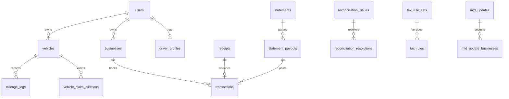

# Proposed PostgreSQL database requirements

Analysis: 27 October 2026. **Every table here is PROPOSED. No backend tables were inspected.** Reconcile with the reported backend users/expenses/auth schema and use reviewed Alembic migrations; do not introduce two expense sources of truth.

## Column and relationship conventions

All tables include `id UUID PRIMARY KEY` (server-generated) and `created_at TIMESTAMPTZ NOT NULL DEFAULT now()`. OWNER tables also include `user_id UUID NOT NULL REFERENCES users(id)`, `updated_at TIMESTAMPTZ NOT NULL DEFAULT now()`, `version INTEGER NOT NULL DEFAULT 1 CHECK(version>0)`. SYSTEM/SHARED tables specify ownership explicitly. `?` marks nullable columns; other columns NOT NULL. No explicit default means value required. DATE is business day, TIMESTAMPTZ is UTC instant. Money BIGINT is integer GBP pence. Mileage NUMERIC(12,2)>=0; percent NUMERIC(5,2) between0 and100. Status/type/method fields require enums/CHECKs corresponding to document06.

Logical `FK table` below means UUID references table(id); same-owner links must additionally use composite FK(user_id,target_id) -> target(user_id,id), backed by UNIQUE(user_id,id), or equivalent enforced tenant ownership. Index owner tables on(user_id,created_at DESC,id DESC) and high-use FKs. RESTRICT deletion of financial/history links; archive/void/reverse under approved retention policy. Nullable links may SET NULL only when evidence/audit retention remains correct. Do not store UI colors/route strings/localized currency as data.

Each table lists columns, keys/indexes/relationships and security. JSONB holds versioned structured/provider/config payloads only; core accounting values and relationships use typed columns. Generic resource IDs and JSON ID arrays need explicit referential/ownership validation, or normalized join tables when queried relationally.

### `users` (SYSTEM)

Common columns: id/created_at above, owner links explicit.

| Column | PostgreSQL type / FK / default |
| --- | --- |
| `phone_e164` | VARCHAR(20)? |
| `email_normalized` | VARCHAR(320)? |
| `first_name` | VARCHAR(100)? |
| `last_name` | VARCHAR(100)? |
| `locale` | VARCHAR(8) DEFAULT en |
| `timezone` | VARCHAR(64) DEFAULT Europe/London |
| `preferences` | JSONB DEFAULT {} |
| `onboarding_complete` | BOOLEAN DEFAULT false |
| `status` | VARCHAR(24) DEFAULT active |
| `updated_at` | TIMESTAMPTZ DEFAULT now() |
| `version` | INT DEFAULT1 |

**Keys/indexes/relationships:** Partial UNIQUE phone/email when non-null; require at least one established identity under chosen auth design; index(status).

**Security/lifecycle:** Mask contacts. Existing password auth if present retains server-only hashes. Never identity-match fixture names.

### `auth_challenges` (SYSTEM)

Common columns: id/created_at above, owner links explicit.

| Column | PostgreSQL type / FK / default |
| --- | --- |
| `user_id` | UUID? FK users |
| `destination_ciphertext` | BYTEA |
| `destination_hash` | BYTEA |
| `purpose` | VARCHAR(16) |
| `code_hash` | BYTEA |
| `expires_at` | TIMESTAMPTZ |
| `resend_after` | TIMESTAMPTZ |
| `attempt_count` | INT DEFAULT0 |
| `max_attempts` | INT |
| `verified_at` | TIMESTAMPTZ? |
| `consumed_at` | TIMESTAMPTZ? |

**Keys/indexes/relationships:** index(destination_hash,purpose,expires_at); attempts>=0; lock active challenge on verify/resend.

**Security/lifecycle:** Nullable user before signup. No plaintext OTP; expire/rate-limit/cleanup; generic errors prevent enumeration.

### `auth_sessions` (OWNER)

Common columns: OWNER convention above.

| Column | PostgreSQL type / FK / default |
| --- | --- |
| `refresh_token_hash` | BYTEA |
| `family_id` | UUID |
| `expires_at` | TIMESTAMPTZ |
| `revoked_at` | TIMESTAMPTZ? |
| `rotated_from_id` | UUID? FK auth_sessions |
| `device_label` | VARCHAR(100)? |
| `last_used_at` | TIMESTAMPTZ? |

**Keys/indexes/relationships:** UNIQUE(refresh_token_hash); index(user_id,revoked_at,expires_at); index(family_id).

**Security/lifecycle:** Rotate/revoke reuse atomically; no raw token logging.

### `provider_identities` (OWNER)

Common columns: OWNER convention above.

| Column | PostgreSQL type / FK / default |
| --- | --- |
| `provider` | VARCHAR(20) |
| `provider_subject` | VARCHAR(255) |
| `verified_email_hash` | BYTEA? |

**Keys/indexes/relationships:** UNIQUE(provider,provider_subject); index(user_id,provider).

**Security/lifecycle:** Validate assertion before link; do not link solely by unverified matching email.

### `driver_profiles` (OWNER)

Common columns: OWNER convention above.

| Column | PostgreSQL type / FK / default |
| --- | --- |
| `licence_type` | VARCHAR(24) |
| `council_code` | VARCHAR(100) |
| `work_pattern` | VARCHAR(24) |

**Keys/indexes/relationships:** UNIQUE(user_id); CHECK enums; one-to-one users, canonical name stays users.

**Security/lifecycle:** Minimize licence data; external validation not assumed.

### `onboarding_progress` (OWNER)

Common columns: OWNER convention above.

| Column | PostgreSQL type / FK / default |
| --- | --- |
| `current_step` | SMALLINT DEFAULT1 |
| `completed_steps` | JSONB DEFAULT [] |
| `skipped_fields` | JSONB DEFAULT [] |
| `completed_at` | TIMESTAMPTZ? |

**Keys/indexes/relationships:** UNIQUE(user_id); current_step BETWEEN1 AND9.

**Security/lifecycle:** Complete only after saved required profile/election validation.

### `businesses` (OWNER)

Common columns: OWNER convention above.

| Column | PostgreSQL type / FK / default |
| --- | --- |
| `type` | VARCHAR(32) |
| `name` | VARCHAR(150) |
| `started_on` | DATE |
| `ended_on` | DATE? |
| `region` | VARCHAR(32) |
| `active` | BOOLEAN DEFAULT true |
| `provider_business_reference_ciphertext` | BYTEA? |

**Keys/indexes/relationships:** index(user_id,type,active); check end>=start.

**Security/lifecycle:** Taxi first; property later from MTD fixture; HMRC business ID restricted.

### `tax_profiles` (OWNER)

Common columns: OWNER convention above.

| Column | PostgreSQL type / FK / default |
| --- | --- |
| `tax_year` | VARCHAR(7) |
| `region` | VARCHAR(32) |
| `has_paye_job` | BOOLEAN DEFAULT false |
| `property_income_pence` | BIGINT? |
| `interest_pence` | BIGINT? |
| `student_loan_plan` | VARCHAR(32)? |
| `marriage_allowance_status` | VARCHAR(32)? |
| `utr_ciphertext` | BYTEA? |
| `ni_ciphertext` | BYTEA? |
| `identifier_key_version` | VARCHAR(32)? |

**Keys/indexes/relationships:** UNIQUE(user_id,tax_year); optional amounts>=0; canonical year format.

**Security/lifecycle:** Encrypt UTR/NI with external keys; mask outputs; exclude from logs/assistant.

### `employments` (OWNER)

Common columns: OWNER convention above.

| Column | PostgreSQL type / FK / default |
| --- | --- |
| `tax_profile_id` | UUID FK tax_profiles |
| `employer_name` | VARCHAR(200) |
| `gross_annual_pay_pence` | BIGINT |
| `tax_paid_pence` | BIGINT DEFAULT0 |
| `tax_code` | VARCHAR(32)? |

**Keys/indexes/relationships:** index(user_id,tax_profile_id); amounts>=0.

**Security/lifecycle:** Private PAYE context, multiple jobs per tax profile.

### `vehicles` (OWNER)

Common columns: OWNER convention above.

| Column | PostgreSQL type / FK / default |
| --- | --- |
| `registration_normalized` | VARCHAR(16) |
| `ownership` | VARCHAR(16) |
| `licence_class` | VARCHAR(32) |
| `make` | VARCHAR(80)? |
| `model` | VARCHAR(80)? |
| `manufacture_year` | SMALLINT? |
| `colour` | VARCHAR(40)? |
| `fuel` | VARCHAR(32)? |
| `business_start_on` | DATE |
| `business_end_on` | DATE? |
| `active` | BOOLEAN DEFAULT true |

**Keys/indexes/relationships:** Partial UNIQUE(user_id,registration_normalized) WHERE active; index(user_id,active); end>=start.

**Security/lifecycle:** Plate private; lookup result does not establish method eligibility.

### `vehicle_claim_elections` (OWNER)

Common columns: OWNER convention above.

| Column | PostgreSQL type / FK / default |
| --- | --- |
| `vehicle_id` | UUID FK vehicles |
| `method` | VARCHAR(16) |
| `effective_from` | DATE |
| `prior_capital_allowances` | BOOLEAN |
| `prior_vehicle_expense_claim` | BOOLEAN |
| `locked_at` | TIMESTAMPTZ |
| `acknowledgement_version` | VARCHAR(40) |
| `rule_set_id` | UUID FK tax_rule_sets |

**Keys/indexes/relationships:** UNIQUE(vehicle_id,effective_from); prohibit overlapping active elections; index(user_id,vehicle_id).

**Security/lifecycle:** Durable vehicle history; locking policy verified by tax specialist, not client flag.

### `income_sources` (SHARED)

Common columns: id/created_at above, owner links explicit.

| Column | PostgreSQL type / FK / default |
| --- | --- |
| `code` | VARCHAR(40) |
| `name` | VARCHAR(100) |
| `kind` | VARCHAR(24) |
| `active` | BOOLEAN DEFAULT true |

**Keys/indexes/relationships:** UNIQUE(code); index(kind,active).

**Security/lifecycle:** Shared catalogs only; private custom operator names need separate owner extension.

### `driver_platforms` (OWNER)

Common columns: OWNER convention above.

| Column | PostgreSQL type / FK / default |
| --- | --- |
| `source_id` | UUID FK income_sources |
| `selected` | BOOLEAN DEFAULT true |
| `selected_at` | TIMESTAMPTZ DEFAULT now() |

**Keys/indexes/relationships:** UNIQUE(user_id,source_id); index(source_id).

**Security/lifecycle:** Selection is not provider OAuth; never store platform passwords.

### `categories` (SHARED)

Common columns: id/created_at above, owner links explicit.

| Column | PostgreSQL type / FK / default |
| --- | --- |
| `code` | VARCHAR(60) |
| `label_key` | VARCHAR(120) |
| `allowed_kinds` | JSONB |
| `requires_vehicle` | BOOLEAN DEFAULT false |
| `policy_code` | VARCHAR(80) |
| `active` | BOOLEAN DEFAULT true |

**Keys/indexes/relationships:** UNIQUE(code); index(active,policy_code).

**Security/lifecycle:** Public reference; private default shares in owner policy table.

### `business_use_policies` (OWNER)

Common columns: OWNER convention above.

| Column | PostgreSQL type / FK / default |
| --- | --- |
| `category_id` | UUID FK categories |
| `percent` | NUMERIC(5,2) |
| `effective_from` | DATE |
| `effective_to` | DATE? |
| `reason` | TEXT? |

**Keys/indexes/relationships:** UNIQUE(user_id,category_id,effective_from); percent0..100; no overlapping ranges via exclusion/locked transaction; index(user_id,category_id,effective_from).

**Security/lifecycle:** No silent rewrite of filed/locked historical records.

### `transactions` (OWNER)

Common columns: OWNER convention above.

| Column | PostgreSQL type / FK / default |
| --- | --- |
| `business_id` | UUID FK businesses |
| `kind` | VARCHAR(16) |
| `amount_pence` | BIGINT |
| `currency` | CHAR(3) DEFAULT GBP |
| `occurred_on` | DATE |
| `source_id` | UUID? FK income_sources |
| `category_id` | UUID? FK categories |
| `vehicle_id` | UUID? FK vehicles |
| `receipt_id` | UUID? FK receipts |
| `payout_id` | UUID? FK statement_payouts |
| `payment_method` | VARCHAR(24) |
| `description` | TEXT? |
| `no_receipt_reason` | TEXT? |
| `business_use_percent` | NUMERIC(5,2) DEFAULT100 |
| `deductible_pence` | BIGINT DEFAULT0 |
| `review_status` | VARCHAR(24) DEFAULT draft |
| `claim_status` | VARCHAR(24) |
| `eligibility_reasons` | JSONB DEFAULT [] |
| `import_origin_key` | VARCHAR(200)? |
| `reversed_at` | TIMESTAMPTZ? |
| `deleted_at` | TIMESTAMPTZ? |

**Keys/indexes/relationships:** amount>0; deductible0..amount; percent0..100; GBP check; confirmed expense category/income source required; partial UNIQUE(user_id,import_origin_key); partial UNIQUE(receipt_id) for one active posting; index(user_id,occurred_on DESC,id DESC), (user_id,review_status,occurred_on), (user_id,source_id,occurred_on), (user_id,category_id,occurred_on).

**Security/lifecycle:** Single canonical ledger; server computes deduction; void/reverse with audit, protect closed periods.

### `private_files` (OWNER)

Common columns: OWNER convention above.

| Column | PostgreSQL type / FK / default |
| --- | --- |
| `storage_key` | TEXT |
| `content_type` | VARCHAR(120) |
| `size_bytes` | BIGINT |
| `sha256` | CHAR(64) |
| `original_name` | VARCHAR(255)? |
| `scan_status` | VARCHAR(24) |
| `retained_until` | DATE? |
| `deleted_at` | TIMESTAMPTZ? |
| `purpose` | VARCHAR(32) |

**Keys/indexes/relationships:** UNIQUE(storage_key); index(user_id,sha256); size>0.

**Security/lifecycle:** Private encrypted storage, sanitized name, authorized expiring downloads; no permanent public URL.

### `processing_jobs` (OWNER)

Common columns: OWNER convention above.

| Column | PostgreSQL type / FK / default |
| --- | --- |
| `kind` | VARCHAR(32) |
| `status` | VARCHAR(24) |
| `resource_type` | VARCHAR(40) |
| `resource_id` | UUID |
| `attempt_count` | INT DEFAULT0 |
| `progress_percent` | SMALLINT? |
| `error_code` | VARCHAR(80)? |
| `retryable` | BOOLEAN DEFAULT false |
| `started_at` | TIMESTAMPTZ? |
| `finished_at` | TIMESTAMPTZ? |

**Keys/indexes/relationships:** index(status,created_at); index(user_id,resource_type,resource_id); progress0..100.

**Security/lifecycle:** Generic resource link service-validated; redact provider payload/error details.

### `receipts` (OWNER)

Common columns: OWNER convention above.

| Column | PostgreSQL type / FK / default |
| --- | --- |
| `business_id` | UUID FK businesses |
| `vehicle_id` | UUID? FK vehicles |
| `file_id` | UUID FK private_files |
| `job_id` | UUID? FK processing_jobs |
| `merchant` | VARCHAR(200)? |
| `occurred_on` | DATE? |
| `amount_pence` | BIGINT? |
| `vat_pence` | BIGINT? |
| `currency` | CHAR(3)? |
| `category_id` | UUID? FK categories |
| `business_use_percent` | NUMERIC(5,2)? |
| `deductible_pence` | BIGINT? |
| `processing_status` | VARCHAR(24) |
| `review_status` | VARCHAR(24) DEFAULT pending |
| `claim_status` | VARCHAR(24) DEFAULT unknown |
| `confirmed_at` | TIMESTAMPTZ? |
| `retained_until` | DATE? |

**Keys/indexes/relationships:** UNIQUE(file_id); index(user_id,review_status,occurred_on DESC,id DESC); index(job_id); amounts>=0; VAT<=amount; claim<=amount; dedup hash warning.

**Security/lifecycle:** Raw extraction separate. Derived transaction_id from transaction.receipt_id avoids two independent mutable links.

### `receipt_extractions` (OWNER)

Common columns: OWNER convention above.

| Column | PostgreSQL type / FK / default |
| --- | --- |
| `receipt_id` | UUID FK receipts |
| `engine_version` | VARCHAR(80) |
| `extracted_fields` | JSONB |
| `confidence` | NUMERIC(5,4)? |
| `warnings` | JSONB DEFAULT [] |
| `attempt_no` | INT |

**Keys/indexes/relationships:** UNIQUE(receipt_id,attempt_no); confidence0..1; index(user_id,receipt_id).

**Security/lifecycle:** Raw attempts retained separately from typed user corrections; minimize unnecessary addresses/payment data.

### `statements` (OWNER)

Common columns: OWNER convention above.

| Column | PostgreSQL type / FK / default |
| --- | --- |
| `business_id` | UUID FK businesses |
| `source_id` | UUID FK income_sources |
| `file_id` | UUID FK private_files |
| `job_id` | UUID? FK processing_jobs |
| `period_start` | DATE? |
| `period_end` | DATE? |
| `processing_status` | VARCHAR(24) |
| `import_status` | VARCHAR(24) DEFAULT preview |
| `imported_at` | TIMESTAMPTZ? |
| `parser_version` | VARCHAR(80)? |
| `warnings` | JSONB DEFAULT [] |

**Keys/indexes/relationships:** UNIQUE(file_id); index(user_id,source_id,period_start,period_end); end>=start.

**Security/lifecycle:** Dedup overlapping payouts, not only filenames; PDF may contain trip addresses despite privacy copy.

### `statement_payouts` (OWNER)

Common columns: OWNER convention above.

| Column | PostgreSQL type / FK / default |
| --- | --- |
| `statement_id` | UUID FK statements |
| `source_id` | UUID FK income_sources |
| `period_start` | DATE |
| `period_end` | DATE |
| `paid_on` | DATE? |
| `gross_pence` | BIGINT |
| `fee_pence` | BIGINT |
| `adjustment_pence` | BIGINT DEFAULT0 |
| `net_pence` | BIGINT |
| `trip_count` | INT? |
| `external_reference_hash` | BYTEA? |
| `import_key` | VARCHAR(200) |

**Keys/indexes/relationships:** UNIQUE(user_id,source_id,import_key); net=gross-fee+adjustment; index(statement_id); index(user_id,source_id,period_start).

**Security/lifecycle:** Separate gross/fee postings once; refunds/negative adjustments need explicit policy.

### `reconciliation_issues` (OWNER)

Common columns: OWNER convention above.

| Column | PostgreSQL type / FK / default |
| --- | --- |
| `business_id` | UUID FK businesses |
| `source_id` | UUID FK income_sources |
| `statement_id` | UUID FK statements |
| `period_start` | DATE |
| `period_end` | DATE |
| `statement_gross_pence` | BIGINT |
| `recorded_gross_pence` | BIGINT |
| `status` | VARCHAR(24) DEFAULT open |
| `resolved_at` | TIMESTAMPTZ? |

**Keys/indexes/relationships:** Unique open issue fingerprint(user,source,statement,period); index(user_id,status,period_start); index(statement_id).

**Security/lifecycle:** Difference derived; scope/basis/snapshot version must match.

### `reconciliation_resolutions` (OWNER)

Common columns: OWNER convention above.

| Column | PostgreSQL type / FK / default |
| --- | --- |
| `issue_id` | UUID FK reconciliation_issues |
| `mode` | VARCHAR(24) |
| `linked_transaction_ids` | JSONB |
| `evidence_note` | TEXT? |
| `mutation_id` | UUID |
| `reversed_at` | TIMESTAMPTZ? |

**Keys/indexes/relationships:** UNIQUE(mutation_id); partial UNIQUE(issue_id) WHERE reversed_at IS NULL; index(user_id,issue_id).

**Security/lifecycle:** Validate linked transaction IDs or normalize join table; atomically resolve/create/link income and fees.

### `mileage_logs` (OWNER)

Common columns: OWNER convention above.

| Column | PostgreSQL type / FK / default |
| --- | --- |
| `business_id` | UUID FK businesses |
| `vehicle_id` | UUID FK vehicles |
| `occurred_on` | DATE |
| `start_odometer` | NUMERIC(12,2)? |
| `end_odometer` | NUMERIC(12,2)? |
| `business_miles` | NUMERIC(12,2) |
| `private_miles` | NUMERIC(12,2)? |
| `purpose` | TEXT |
| `source` | VARCHAR(24) DEFAULT manual |
| `voided_at` | TIMESTAMPTZ? |

**Keys/indexes/relationships:** miles>=0; end>=start; business+private<=delta where known; index(user_id,vehicle_id,occurred_on,id).

**Security/lifecycle:** No GPS collection implied; prevent overlapping/duplicate logs; correct cumulative deduction bands.

### `tax_rule_sets` (SHARED)

Common columns: id/created_at above, owner links explicit.

| Column | PostgreSQL type / FK / default |
| --- | --- |
| `tax_year` | VARCHAR(7) |
| `region` | VARCHAR(32) |
| `version_label` | VARCHAR(40) |
| `status` | VARCHAR(24) DEFAULT draft |
| `verified_at` | TIMESTAMPTZ? |
| `official_url` | TEXT |
| `approved_by_reference` | VARCHAR(100)? |

**Keys/indexes/relationships:** UNIQUE(tax_year,region,version_label); index(tax_year,region,status).

**Security/lifecycle:** Admin-only publication; immutable published rules and official verification evidence.

### `tax_rules` (SHARED)

Common columns: id/created_at above, owner links explicit.

| Column | PostgreSQL type / FK / default |
| --- | --- |
| `rule_set_id` | UUID FK tax_rule_sets |
| `code` | VARCHAR(80) |
| `parameters` | JSONB |
| `effective_from` | DATE |
| `effective_to` | DATE? |
| `official_url` | TEXT |

**Keys/indexes/relationships:** UNIQUE(rule_set_id,code,effective_from); index(rule_set_id,code); effective_to>=from.

**Security/lifecycle:** Validate parameter schemas; never execute client-provided formulas.

### `tax_estimate_snapshots` (OWNER)

Common columns: OWNER convention above.

| Column | PostgreSQL type / FK / default |
| --- | --- |
| `business_id` | UUID? FK businesses |
| `tax_year` | VARCHAR(7) |
| `rule_set_id` | UUID FK tax_rule_sets |
| `profile_version` | INT |
| `ledger_version` | VARCHAR(120) |
| `as_of` | TIMESTAMPTZ |
| `input_digest` | CHAR(64) |
| `result` | JSONB |
| `estimate_only` | BOOLEAN DEFAULT true |

**Keys/indexes/relationships:** UNIQUE(user_id,tax_year,rule_set_id,input_digest); index(user_id,tax_year,as_of DESC).

**Security/lifecycle:** Reproducible private outputs, not user-editable liabilities; validate result schema.

### `tax_payments` (OWNER)

Common columns: OWNER convention above.

| Column | PostgreSQL type / FK / default |
| --- | --- |
| `tax_year` | VARCHAR(7) |
| `type` | VARCHAR(32) |
| `due_on` | DATE? |
| `amount_pence` | BIGINT |
| `paid_on` | DATE? |
| `status` | VARCHAR(24) |
| `source` | VARCHAR(32) |
| `external_reference_hash` | BYTEA? |

**Keys/indexes/relationships:** index(user_id,tax_year,type,due_on); amount>=0.

**Security/lifecycle:** Separate assessed liability, advances, actual payments and estimates; provenance mandatory.

### `tax_pot_entries` (OWNER)

Common columns: OWNER convention above.

| Column | PostgreSQL type / FK / default |
| --- | --- |
| `tax_year` | VARCHAR(7) |
| `amount_pence` | BIGINT |
| `occurred_on` | DATE |
| `note` | TEXT? |
| `reversal_of` | UUID? FK tax_pot_entries |
| `mutation_id` | UUID |

**Keys/indexes/relationships:** amount>0; UNIQUE(mutation_id); partial UNIQUE(reversal_of) non-null; index(user_id,tax_year,occurred_on DESC,id DESC).

**Security/lifecycle:** Balance additions minus identified reversal entries; original/reversal amount matches; no bank transfer.

### `notifications` (OWNER)

Common columns: OWNER convention above.

| Column | PostgreSQL type / FK / default |
| --- | --- |
| `type` | VARCHAR(60) |
| `title_key` | VARCHAR(150) |
| `body_key` | VARCHAR(150) |
| `params` | JSONB |
| `resource_type` | VARCHAR(40)? |
| `resource_id` | UUID? |
| `read_at` | TIMESTAMPTZ? |
| `dedupe_key` | VARCHAR(200)? |

**Keys/indexes/relationships:** Partial UNIQUE(user_id,dedupe_key) non-null; index(user_id,read_at,created_at DESC,id DESC).

**Security/lifecycle:** Minimal personal push data, known resource kinds, owner validation before deep link.

### `subscription_plans` (SHARED)

Common columns: id/created_at above, owner links explicit.

| Column | PostgreSQL type / FK / default |
| --- | --- |
| `code` | VARCHAR(60) |
| `price_pence` | BIGINT |
| `currency` | CHAR(3) DEFAULT GBP |
| `interval` | VARCHAR(16) |
| `trial_days` | INT DEFAULT0 |
| `cohort_label` | VARCHAR(80) |
| `terms_version` | VARCHAR(40) |
| `provider_product_reference` | VARCHAR(200)? |
| `active` | BOOLEAN DEFAULT true |

**Keys/indexes/relationships:** UNIQUE(code,terms_version); price/trial>=0; index(active).

**Security/lifecycle:** Public offer, immutable price/terms history; no payment secrets.

### `subscriptions` (OWNER)

Common columns: OWNER convention above.

| Column | PostgreSQL type / FK / default |
| --- | --- |
| `plan_id` | UUID FK subscription_plans |
| `status` | VARCHAR(24) |
| `trial_start` | TIMESTAMPTZ? |
| `trial_end` | TIMESTAMPTZ? |
| `price_locked_pence` | BIGINT? |
| `renew_at` | TIMESTAMPTZ? |
| `provider` | VARCHAR(24)? |
| `provider_subscription_reference` | VARCHAR(200)? |
| `trial_used_at` | TIMESTAMPTZ? |

**Keys/indexes/relationships:** Partial UNIQUE(user_id) active/trialing under policy; UNIQUE(provider,provider_subscription_reference) non-null; index(user_id,status).

**Security/lifecycle:** Signed provider status determines entitlements; single trial policy; no card data.

### `billing_events` (SYSTEM)

Common columns: id/created_at above, owner links explicit.

| Column | PostgreSQL type / FK / default |
| --- | --- |
| `provider` | VARCHAR(24) |
| `provider_event_id` | VARCHAR(200) |
| `subscription_id` | UUID? FK subscriptions |
| `event_type` | VARCHAR(100) |
| `verified_at` | TIMESTAMPTZ |
| `processed_at` | TIMESTAMPTZ? |
| `payload_redacted` | JSONB |
| `status` | VARCHAR(24) |

**Keys/indexes/relationships:** UNIQUE(provider,provider_event_id); index(status,created_at).

**Security/lifecycle:** Verify signature/replay; minimal redacted retention, no payment secrets.

### `export_jobs` (OWNER)

Common columns: OWNER convention above.

| Column | PostgreSQL type / FK / default |
| --- | --- |
| `tax_year` | VARCHAR(7) |
| `format` | VARCHAR(16) |
| `include_photos` | BOOLEAN DEFAULT false |
| `snapshot_digest` | CHAR(64) |
| `job_id` | UUID FK processing_jobs |
| `file_id` | UUID? FK private_files |
| `expires_at` | TIMESTAMPTZ? |
| `status` | VARCHAR(24) |

**Keys/indexes/relationships:** index(user_id,status,created_at DESC); index(job_id).

**Security/lifecycle:** Owner/scoped-recipient download; expiring file; safe CSV; no raw identifiers by default.

### `accountant_requests` (OWNER)

Common columns: OWNER convention above.

| Column | PostgreSQL type / FK / default |
| --- | --- |
| `kind` | VARCHAR(32) |
| `export_id` | UUID? FK export_jobs |
| `recipient_reference` | VARCHAR(200) |
| `message` | TEXT? |
| `consent_record_id` | UUID FK consent_records |
| `status` | VARCHAR(24) |
| `delivered_at` | TIMESTAMPTZ? |
| `completed_at` | TIMESTAMPTZ? |

**Keys/indexes/relationships:** index(user_id,status,created_at); index(export_id).

**Security/lifecycle:** Verified recipient/consent; no assumed TaxAssist link; request != delivery != filing.

### `consent_records` (OWNER)

Common columns: OWNER convention above.

| Column | PostgreSQL type / FK / default |
| --- | --- |
| `purpose` | VARCHAR(60) |
| `version_label` | VARCHAR(40) |
| `recipient_reference` | VARCHAR(200)? |
| `scope` | JSONB |
| `accepted_at` | TIMESTAMPTZ |
| `revoked_at` | TIMESTAMPTZ? |

**Keys/indexes/relationships:** index(user_id,purpose,accepted_at DESC).

**Security/lifecycle:** Append-only evidence; scope must not copy sensitive source data.

### `hmrc_connections` (OWNER)

Common columns: OWNER convention above.

| Column | PostgreSQL type / FK / default |
| --- | --- |
| `provider` | VARCHAR(24) DEFAULT hmrc |
| `access_token_ciphertext` | BYTEA? |
| `refresh_token_ciphertext` | BYTEA? |
| `encryption_key_version` | VARCHAR(40) |
| `expires_at` | TIMESTAMPTZ? |
| `scopes` | JSONB |
| `status` | VARCHAR(24) |
| `last_verified_at` | TIMESTAMPTZ? |
| `pending_state_hash` | BYTEA? |
| `state_expires_at` | TIMESTAMPTZ? |

**Keys/indexes/relationships:** UNIQUE(user_id,provider); index(status,expires_at).

**Security/lifecycle:** Server-only encrypted tokens; one-use expiring state; least-privilege workers.

### `mtd_obligations` (OWNER)

Common columns: OWNER convention above.

| Column | PostgreSQL type / FK / default |
| --- | --- |
| `business_id` | UUID FK businesses |
| `provider_obligation_key` | VARCHAR(200) |
| `period_start` | DATE |
| `period_end` | DATE |
| `due_on` | DATE |
| `status` | VARCHAR(24) |
| `received_on` | DATE? |
| `retrieved_at` | TIMESTAMPTZ |

**Keys/indexes/relationships:** UNIQUE(user_id,business_id,provider_obligation_key); index(user_id,status,due_on).

**Security/lifecycle:** Retrieve authoritative obligations; keep provider business mappings restricted.

### `mtd_previews` (OWNER)

Common columns: OWNER convention above.

| Column | PostgreSQL type / FK / default |
| --- | --- |
| `tax_year` | VARCHAR(7) |
| `snapshot_hash` | CHAR(64) |
| `ledger_version` | VARCHAR(120) |
| `payload` | JSONB |
| `obligation_ids` | JSONB |
| `warnings` | JSONB DEFAULT [] |
| `can_submit` | BOOLEAN |
| `expires_at` | TIMESTAMPTZ |

**Keys/indexes/relationships:** UNIQUE(user_id,snapshot_hash); index(user_id,created_at DESC).

**Security/lifecycle:** Immutable per-business preview; validate obligation ownership; edits invalidate snapshot.

### `mtd_updates` (OWNER)

Common columns: OWNER convention above.

| Column | PostgreSQL type / FK / default |
| --- | --- |
| `preview_id` | UUID FK mtd_previews |
| `consent_record_id` | UUID FK consent_records |
| `status` | VARCHAR(24) |
| `idempotency_key` | UUID |
| `submitted_at` | TIMESTAMPTZ? |
| `accepted_at` | TIMESTAMPTZ? |
| `error_code` | VARCHAR(100)? |
| `confirmation_file_id` | UUID? FK private_files |

**Keys/indexes/relationships:** UNIQUE(user_id,idempotency_key); index(user_id,status,created_at DESC); index(preview_id).

**Security/lifecycle:** queued/submitting/accepted/rejected/partial/unknown distinct; never invent confirmation or resend blindly.

### `mtd_update_businesses` (OWNER)

Common columns: OWNER convention above.

| Column | PostgreSQL type / FK / default |
| --- | --- |
| `update_id` | UUID FK mtd_updates |
| `business_id` | UUID FK businesses |
| `obligation_id` | UUID FK mtd_obligations |
| `provider_reference_ciphertext` | BYTEA? |
| `status` | VARCHAR(24) |
| `accepted_at` | TIMESTAMPTZ? |
| `error_payload_redacted` | JSONB? |

**Keys/indexes/relationships:** UNIQUE(update_id,business_id,obligation_id); index(user_id,business_id,status).

**Security/lifecycle:** Separate taxi/property outcomes and retry rules; restrict provider references.

### `assistant_conversations` (OWNER)

Common columns: OWNER convention above.

| Column | PostgreSQL type / FK / default |
| --- | --- |
| `locale` | VARCHAR(8) |
| `consent_record_id` | UUID FK consent_records |
| `title` | VARCHAR(150)? |
| `closed_at` | TIMESTAMPTZ? |

**Keys/indexes/relationships:** index(user_id,created_at DESC).

**Security/lifecycle:** Future feature with explicit consent, minimal context/retention.

### `assistant_messages` (OWNER)

Common columns: OWNER convention above.

| Column | PostgreSQL type / FK / default |
| --- | --- |
| `conversation_id` | UUID FK assistant_conversations |
| `role` | VARCHAR(16) |
| `content` | TEXT |
| `client_message_id` | UUID? |
| `status` | VARCHAR(24) |
| `sources` | JSONB DEFAULT [] |

**Keys/indexes/relationships:** Partial UNIQUE(conversation_id,client_message_id) non-null; index(user_id,conversation_id,created_at,id).

**Security/lifecycle:** Sanitize display; redact secrets; tenant isolate context; no implicit write authority.

### `audit_events` (OWNER)

Common columns: OWNER convention above.

| Column | PostgreSQL type / FK / default |
| --- | --- |
| `mutation_id` | UUID |
| `action` | VARCHAR(80) |
| `resource_type` | VARCHAR(60) |
| `resource_id` | UUID |
| `before_digest` | CHAR(64)? |
| `after_digest` | CHAR(64)? |
| `reversal_of` | UUID? FK audit_events |
| `actor_type` | VARCHAR(24) |
| `actor_reference` | VARCHAR(150)? |
| `reason` | TEXT? |

**Keys/indexes/relationships:** UNIQUE(mutation_id); index(user_id,resource_type,resource_id,created_at); unique reversal relation under policy.

**Security/lifecycle:** Append-only redacted audit; no raw UTR/NI/token/file content; polymorphic links service validated.

### `idempotency_records` (OWNER)

Common columns: OWNER convention above.

| Column | PostgreSQL type / FK / default |
| --- | --- |
| `request_key` | UUID |
| `method` | VARCHAR(8) |
| `request_path` | VARCHAR(255) |
| `request_digest` | CHAR(64) |
| `response_status` | SMALLINT? |
| `response_redacted` | JSONB? |
| `resource_type` | VARCHAR(50)? |
| `resource_id` | UUID? |
| `expires_at` | TIMESTAMPTZ |
| `state` | VARCHAR(24) |

**Keys/indexes/relationships:** UNIQUE(user_id,request_key,method,request_path); index(expires_at).

**Security/lifecycle:** Bind digest to canonical method, concrete resource path and request body; replay window covers retries; token responses never cached plaintext; auth token replay handled separately.

## Count and integrity

46 proposed tables including infrastructure/future integrations, not existing tables or all required for MVP.

Shared catalogs/users precede profile/business/vehicle; then private files/jobs/receipts/statements, ledger/policies/mileage, audit/reversals/reports, then exports/billing/HMRC/assistant. Canonical transaction.receipt_id avoids circular mandatory inserts; job.resource_id remains validated by service. Use ordered Alembic migrations and review existing backend expense ownership/conventions first.

Lock/version-check confirmation, imports, election, overlapping policy ranges, resolution and reversal. Aggregate caches disposable; tax snapshots reproducible. RLS optional defense-in-depth, not replacement for same-owner queries/constraints. Authorize private object access on every download. Approve UK storage/retention/address minimization before making UI privacy promises; handle legal holds and statutory evidence versus unnecessary personal data. Key management/rotation stays outside DB. No migrations or backend code implemented in this task.

