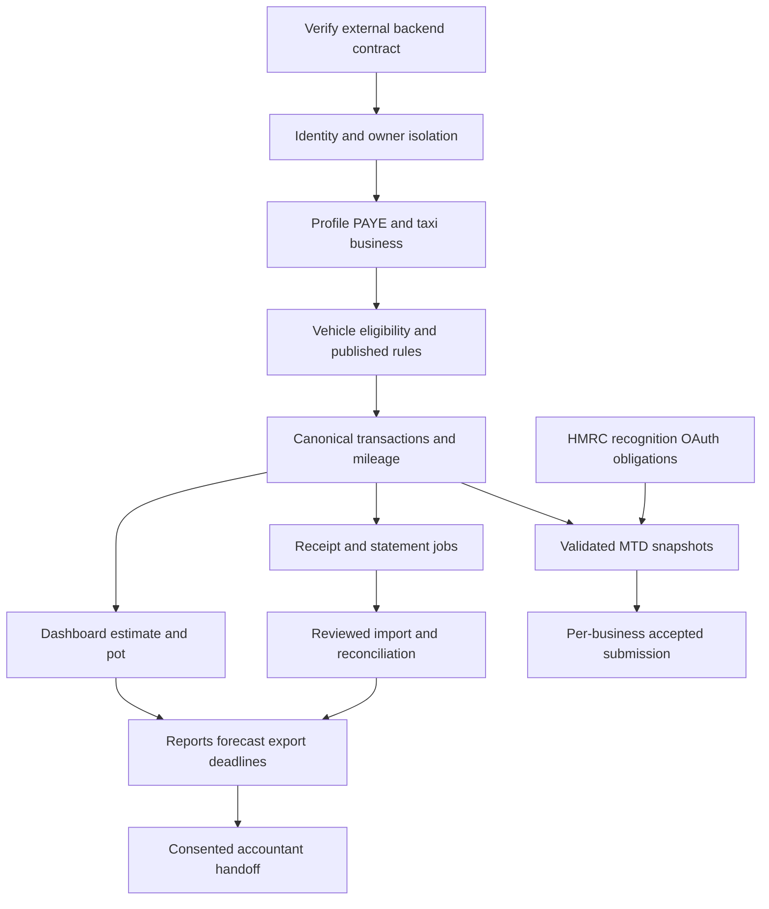

# Backend implementation roadmap

Analysis: 27 October 2026. PROPOSED sequence, not an existing backend implementation plan already agreed with another agent. Six source modules contain 58 screens; the 93-operation catalog is requirements coverage including 15 extensions, not an MVP endpoint quota. Reported registration/login/JWT/expense CRUD/tests must be verified and reused first.

## Priorities and dependencies

| Priority | Feature | Dependencies / API groups | Definition of done |
| --- | --- | --- | --- |
| P0 | Verify existing backend contract and authentication | Inspect OpenAPI, migration history, tests and env names; A01/A02/A04-A07/A06; OTP versus existing password/email decision | Stable versioned contract, owner isolation, session refresh/logout, generic auth errors; no frontend fake Face ID trust |
| P0 | User/onboarding/driver/PAYE/tax inputs | P01-P07/F01; authenticated user; default taxi business created or linked on driver-profile save | Persist/resume actual choices, optional encrypted identifiers, no forced demo data |
| P0 | Vehicle and eligible claim election | V02-V05; driver/licence history and rule publication | Actual vehicle IDs and policy; Hackney/commercial/prior-claim checks; durable method election |
| P0 | Canonical income/expense ledger | L01-L06; existing expense CRUD adapter; sources I01-I02/categories F01 | Bound/validated create/edit/void; integer GBP values, independent review/claim state, auditable exact reversals |
| P0 | Business-use policy and review integrity | R04/R05/R07, transaction rules; no receipt acquisition required for basic manual expenses | Correct per-record share and effective default; no false save/preview totals |
| P0 | Manual mileage evidence | M01-M04; eligible vehicle, missing log form to be separately implemented | Evidence, duplicate/correction handling, tax-year band crossing; no fake 8240 miles |
| P0 | Verified baseline tax estimate/dashboard | T01/T05/R01/R02/K01-K03; PAYE/region/rule version and consistent ledger | Same totals across views, zero/empty/loss handling, estimate warnings, durable savings log; no banking claims |
| P1 | Receipt capture/OCR/review | C01-C08; native camera/gallery/file permission, private storage, worker, canonical ledger | Real capture, pending/failed/manual fallback, edits confirmed atomically, idempotent reversal and true counts |
| P1 | PDF import and reconciliation | D01-D05/Q01-Q04; source-specific parser, gross/fee model, dedup, ledger | Preview/import real statements; missing/link-existing resolution updates books; exact undo; no double counted net |
| P1 | Reports/forecast/POA/timeline | R03/R06/T02-T04; official eligibility, prior-year assessed/payment inputs missing from current UI | Reproducible aggregate snapshots, historical-year rates and explicit forecast assumptions; final liability distinguished |
| P1 | Notifications/deadlines | N01-N04; preferences/native permission, scheduler/provider choice | Real owner feed/read state, deterministic dates, actual device-calendar success |
| P1 | Export and trial offer | E01-E03/S01-S03; private job/file pipeline and approved terms | Real selected-year PDF/approved spreadsheet and receipt package; actual trial/cohort server dates |
| P1 | Vehicle lookup/corrections | V01/V06; provider terms and fallback | Plate lookup safely fails/manual fallback; edits cannot bypass method history |
| P1 | Provider registration | A03; selected Apple/Google project configuration | Verified assertion/nonce/issuer, account-linking policy, real UI auth errors |
| P1 | MTD eligibility guidance only | U01; verified qualifying-income years/exemptions | Evidence-based likely/not-required/unknown result; connection/capability status, no sending |
| P2 | Accountant workflow | H01-H02; E01-E03, verified recipient, consent/delivery service | Consented request and tracked delivery; no filing success implied |
| P2 | Paid subscription operations | S04-S06; chosen store/provider and new management screens | Verified webhook/purchase events, renewal/cancel/dunning, entitlement/price-lock policy |
| P2 | Real HMRC MTD submission | U02-U10; recognition, OAuth, secure provider vault, business/obligation sync, immutable ledger | Sandbox then reviewed production path, per-business acceptance, partial/unknown reconciliation, saved acknowledgement |
| P3 | Multilingual assistant | B01-B03; new conversation UI, approved provider/context/consent policy | Tenant-isolated conversations, useful sources, no implicit filing/ledger writes |
| P3 | Full localization/RTL, desktop layouts, advanced tracking/bank links | Missing UI/product scope; no bank/GPS contracts inferred | Separately specified and authorized frontend/platform work |

## Logical delivery order

1. Compare external OpenAPI/tests against this handoff. Record a real existing/proposed mapping; choose version adapters instead of replacing tested auth/expense behavior blindly.
2. Establish identity/ownership, reference catalogs, canonical taxi business, driver/onboarding/PAYE and preferences. Publish reviewed rule versions and define storage/retention policy.
3. Vehicle eligibility/election, sources/categories, manual fares/expenses, work-share policy and manual mileage. Ensure all persisted IDs flow into detail routes; current Flutter changes remain a separate task.
4. Consistent dashboard/weekly report/estimate and tax pot. Verify core money arithmetic, date ranges, cross-user isolation, optimistic conflicts, duplicate writes and reversals.
5. Private file/worker pipeline, actual camera/file input, OCR review, PDF preview/import and reconciliation. Extend meaningful tests for failed jobs, malformed files, duplicate imports and gross/fee/net accounting.
6. Annual/category/personal reports, forecast/POA/deadlines/read state, export and trial. Resolve prior-year assessed tax inputs and spreadsheet format first.
7. Accountant and paid billing after partners/providers/terms. MTD eligibility can precede authorization; submission only after recognition and provider acceptance flow are real.
8. Assistant/localization/desktop or advanced capture only against explicit future requirements.

## Validation and rollout requirements for the future backend agent

Use existing automated tests as evidence only after running them in the backend environment. Add behavior tests for tenant isolation, expired/reused tokens, six-digit invalid OTP rejection, real field validation, money rounding, share overrides, mileage crossing/year changes, statement dedup/overlap, link-existing resolution, action-specific reversal, frozen MTD snapshots and unknown provider outcomes. Verify actual UI loading/empty/error/retry states when a separately authorized frontend integration occurs. Docker/DB backups, migrations and workers must be testable in a controlled environment; no deployment performed here.

This task added documentation only. Flutter tests/analyzer were inspected but not executed: they do not validate prose contracts and may create tool/build artifacts. Documentation coverage/link/count checks and source-preservation checks are recorded in the master document.
